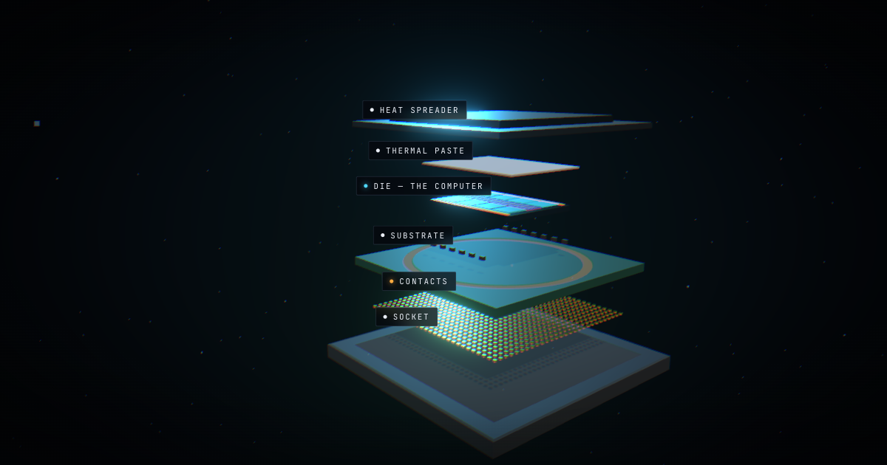

# Anatomy of a Machine

A free, interactive course on how computers actually work, taught by taking
one apart. Start at a chip you could hold in your hand, go down to a single
transistor, then come back up through memory, boot, the kernel and the
compiler, and out to phones, cars, robots, datacenters and a computer
inside a skull.

**Take the course: https://anatomy.useful-shit.org**

Each lecture is a short deck of beats. A beat is one idea: a few sentences,
and a 3D model framed to show exactly that idea. You step through at your own
pace or press play and a narrator reads it, pointing at each part as she
names it. Every 3D scene is generated in code. There are no model files.

## What you'll learn

The course has one argument: every machine is built from the same few
things (switches, wires, memory, a clock) under a different budget. A phone
chip, a car's controller and a datacenter accelerator aren't different
technologies. They're the same technology with different things given up.
So each lecture names what dominated the design and what was traded away
for it.

| # | Lecture | What it covers | The trade |
| --- | --- | --- | --- |
| 1 | [The Chip](https://anatomy.useful-shit.org/#/chip/0) | From a slab you can hold down to a single switch, and back up again | None yet: this is the vocabulary. |
| 2 | [Memory & State](https://anatomy.useful-shit.org/#/memory/0) | A gate that remembers, and the ladder of copies around it | Distance is time. Every memory technology is a bribe paid for a shorter walk. |
| 3 | [Time](https://anatomy.useful-shit.org/#/time/0) | Clocks, pipelines, and why clock speed stopped climbing | Light only moves so far per tick. Everything clever in a core is an attempt to not wait. |
| 4 | [How Silicon Is Made](https://anatomy.useful-shit.org/#/fab/0) | Printing a circuit with light | You are printing with light at a wavelength larger than the thing you are printing. |
| 5 | [The Board](https://anatomy.useful-shit.org/#/board/0) | A laptop, taken apart the way the package was | A sealed box with a fixed power and heat budget. |
| 6 | [I/O](https://anatomy.useful-shit.org/#/io/0) | Interrupts, DMA, and how a machine touches the world | The world is analogue, asynchronous, and does not wait for you. |
| 7 | [Boot](https://anatomy.useful-shit.org/#/boot/0) | Voltage rises, and eleven seconds later there is a prompt | At t=0 nothing is initialised, including the thing that initialises things. |
| 8 | [The Kernel](https://anatomy.useful-shit.org/#/kernel/0) | Rings, syscalls, scheduling, and virtual memory | One machine, many programs, none of which trust each other. |
| 9 | [Operating Systems](https://anatomy.useful-shit.org/#/os/0) | Monolithic and micro, Linux and NT and Darwin, and the RTOS | Who decides what runs next, and can you prove it decides in time. |
| 10 | [From Code to Current](https://anatomy.useful-shit.org/#/compile/0) | Source, compiler, ISA, machine code, and the transistors that switch | Closes the loop back to Lecture 1. |
| 11 | [The Phone](https://anatomy.useful-shit.org/#/phone/0) | Nearly everything on one die, in a sealed slab with no fan | Energy per task. Traded: sustained performance, serviceability, thermal headroom. |
| 12 | [The Edge](https://anatomy.useful-shit.org/#/edge/0) | Microcontrollers, bare metal, and sub-watt budgets | Power, and no human nearby. Traded: an OS, a screen, the assumption you can reboot it. |
| 13 | [The Car](https://anatomy.useful-shit.org/#/car/0) | Zonal architecture, lockstep cores, and computers that must not fail | It must not fail, for fifteen years, in a vibrating oven. Traded: cutting-edge silicon, cost, update freedom. |
| 14 | [The Robot](https://anatomy.useful-shit.org/#/robot/0) | Sense, plan, act — and the deadline that cannot slip | Close a physical loop before the world moves. Traded: generality. |
| 15 | [The Datacenter](https://anatomy.useful-shit.org/#/datacenter/0) | Racks, interconnect, and machines that never stop | Throughput per watt per dollar, times a hundred thousand. |
| 16 | [The Extremes](https://anatomy.useful-shit.org/#/extremes/0) | Space, radiation, and computers that are not von Neumann | Survival. Traded: everything else, cheerfully. |
| 17 | [The Implant](https://anatomy.useful-shit.org/#/implant/0) | A computer that has to think inside a skull, on a few tens of milliwatts | You may not heat the tissue, you may not change the battery, and you cannot get the data out. |

All seventeen are written and narrated: 66 chapters, 183 beats. The full map,
including why the lectures come in this order, is in
[`docs/CURRICULUM.md`](docs/CURRICULUM.md).

### How to use it

| Do this | To |
| --- | --- |
| `←` `→` `Space`, or the arrow buttons | step one beat |
| `Home` / `End` | jump to the first / last beat |
| `P`, or the play button | let the narrator take you through it |
| `C` | flip a comparison beat between its two states |
| drag, or one finger | turn the model |
| wheel, pinch, `+` / `-` | zoom |
| hover or tap a part | see what it is |
| `Esc` | back to the syllabus |

Underlined words have a one-line definition. Small numbers after a sentence
open its source. "Sources & credits" lists everything a lecture stands on.
Captions and mute are in the controls, so the guided tour works with the
sound off.

Every beat has its own link (`#/<lecture>/<beat>`, counting from 0), so you
can send someone straight to the part that made it click.

### Can I trust it?

The copy is checked against sources, not written from memory. Every
citation was opened and read against the sentence it supports, and anything
that could not be confirmed was left out rather than cited on trust
([`src/content/sources.ts`](src/content/sources.ts)). A fact-check pass
reviewed 150 flagged claims and corrected most of them; the full log, with
what changed and why, is in [`docs/FACT-CHECK.md`](docs/FACT-CHECK.md).

Some things are drawn for teaching rather than to scale. A real gate oxide is
about a nanometre thick against a gate tens of nanometres long, which would be
invisible, so the transistor's thicknesses are stylised while its structure is
faithful. Where a scene simplifies, the copy says so.

Found something wrong? Open an issue with the lecture, the beat link and a
source.

## Run it yourself

```bash
npm install
npm run dev        # http://localhost:5173
npm run build      # typecheck, then a static build in dist/
```

Checks, all of which CI or the dev build run:

```bash
npm test                              # unit tests (analytics validator, opt-out)
npm run typecheck
npm run lint
npm run check:refs                    # every citation still matches its sentence
node scripts/check-narration.mjs      # narration cues point at things that exist
```

[`docs/CHECKS.md`](docs/CHECKS.md) covers verifying a change by eye: the beat
audit, measuring an animation, layouts at real sizes, and the traps that have
already caught someone.

## How it's built

| Package | Version | Why |
| --- | --- | --- |
| `vite` | 8.2 | Static build, no SSR to fight with WebGL |
| `react` | 19.2 | The copy, the controls, the syllabus |
| `three` | 0.185 | Everything 3D |
| `@react-three/fiber` | 9.7 | React renderer for three |
| `@react-three/drei` | 10.7 | `Environment`, `Lightformer`, `Html` |
| `@react-three/postprocessing` | 3.0 | Bloom, tone mapping, grain, vignette |
| `zustand` | 5.0 | The handful of values React needs to see |

### The deck: the timeline is an integer

The course is a list of steps, not a scrolling page. `src/deck/deck.ts`
flattens every beat of every lecture into one ordered list per lecture,
built once at load. Where the reader is is an index into that list: `to` is
where they asked to be, and `current` eases toward it over 0.85 s.

That replaced an earlier scroll-driven version, where the geometry of the
page *was* the timeline and had to be measured, re-measured on resize and
mirrored by hand in places that drifted apart. An integer can't drift. A
chapter boundary is not special either: the camera glides from the last beat
of one chapter into the first of the next exactly as it does between any
two beats.

Stepping is deliberate only. Wheel-to-step was tried and removed: a mouse
wheel sends notches but a trackpad sends a long decaying stream, so one
flick skipped five beats, and no threshold fixed it without making presses
feel dropped. So continuous gestures move the camera, where continuous is
what you want, and only keys and buttons move the deck
(`src/deck/useDeckInput.ts`).

### Two update rates, two paths

The single most important rule: **things that change every frame never go
through React.**

```
input -> deck (index)  ->  driver: once per frame  ->  camera, explode, focus, signal tick
              |
              +-> zustand: which beat is showing  ->  copy card, counter, URL
```

The deck position, the pointer position and the camera all change every
frame, so they live in plain mutable objects the render loop reads. Only
discrete things (which beat is on screen, which part is hovered) go through
zustand into the DOM. Routing per-frame values through React state would
re-render the whole page sixty times a second.

`src/three/driver.ts` turns the deck position into scene state: which scene,
camera, explode amount, spotlit part, and seconds since the beat arrived. It
memoises on the frame stamp, so it runs exactly once per frame however many
components ask, which avoids depending on R3F's `useFrame` priority order
(a priority above 0 silently takes over the render loop).

### Scenes and parts

Twenty procedural scenes live in `src/three/scenes/`. Only the scenes the
current lecture uses are mounted: lecture 1 needs five, most lectures need
one. Entering a lecture is a cut, so swapping scenes there is invisible.
Inside a lecture every scene stays mounted, and scenes you can't see update
at about 10 Hz instead of 60 (`useSceneFrame` in `src/three/layers.ts`), so
a chapter is already correct the moment you arrive in it.

A chapter change is a cut on the frame where the camera moves fastest, and
the arriving scene settles the last 16% into place. The two alternatives
both shipped as bugs: overlapping scenes left a ghost of the last chapter
on screen, and sequential fades left an empty frame that read as a blink.

The building blocks:

- **`Part`**: one addressable piece. It explodes along its own vector, dims
  when something else is spotlit, and names itself under the pointer. Dimming
  lerps colour toward the background rather than using opacity, because
  transparent coplanar slabs flicker.
- **Naming by role** (`src/three/naming.ts`): a memory array is two hundred
  identical cells, so instead of an id each, geometry is named by what it
  *is*. Point at any capacitor and you're told what a capacitor is.
- **Annotations** anchor to parts through a live registry, so a label follows
  its geometry as the model explodes.
- **Flow and lanes** (`src/three/motion/`): moving data is a deterministic
  function of packet index and time along a route measured by arc length.
  No randomness, so the motion is reproducible and therefore teachable.
- **Surfaces** (`src/three/surfaces.ts`): silicon, solder mask and copper are
  painted onto canvases from a fixed seed at first use, because a material
  reads by its texture long before its colour.

### The copy can't disagree with the model

Several scenes animate real logic, and the copy shows the same state the 3D
draws. `src/three/signal.ts` is the source of truth for the logic gates:
everything derives from one integer tick, so the lit wires and the
highlighted row of the truth table in the copy card can't drift apart. A
table that lagged the geometry would teach the wrong thing.

`src/three/readout.ts` generalises that. A scene publishes the number its
copy is about (the wiring saved, the throttle factor, the bus priority that
wins) and a beat with `readout: true` shows it live, so a claim is something
you watch change rather than something you're asked to believe.

Beats that state a comparison (DDR against PCIe, polling against interrupts)
declare a `toggle`, and the scene shows either side from the same camera, in
the same frame. That's the only arrangement where you can actually judge a
difference.

### Words and sources are layered on, not written in

Beat copy is plain strings. At render time `src/ui/Rich.tsx` underlines terms
from `src/content/jargon.ts` (once per chapter, where the reader first meets
them) and places citation markers from `src/content/references.ts`, which are
anchored to exact phrases of the copy. `npm run check:refs` fails if an edit
orphans a citation. Hovering a part shows its entry in
`src/content/glossary.ts`: the copy explains the idea, the glossary names the
object.

### Layout

```
src/
  content/
    lectures.ts         the course: every lecture, in order
    chapters.ts         lecture 1; one file per lecture beside it
    types.ts            Lecture -> Chapter -> Beat, and what a beat can do
    glossary.ts         what each piece of geometry is
    jargon.ts           definitions for words in the copy
    references.ts       citations, anchored to phrases of the copy
  deck/
    deck.ts             the step list, position and tween
    useDeckInput.ts     keyboard, pointer, touch
    useHashRoute.ts     #/lecture/beat links
    narration.ts        the narrator, captions and autoplay
  three/
    driver.ts           deck position -> scene state, once per frame
    Scene.tsx           which scenes mount, camera rig, lighting
    Part.tsx            one addressable piece: explodes, dims, isolates
    layers.ts           throttling scenes nobody can see
    signal.ts           truth-table clock shared by the 3D and the copy
    readout.ts          live numbers a scene shows in the copy card
    motion/             packets moving along routes
    scenes/             the twenty scenes, each with its layout file
  ui/                   copy card, controls, syllabus, sources, tooltips
  lib/track.ts          privacy-first reader analytics
worker/index.ts         the one server endpoint: analytics events
scripts/                narration renderer and checks
docs/                   curriculum, motion rules, checks, fact-check log
```

### Adding a chapter

Most chapters need no new engineering. Add a chapter to a lecture's file in
`src/content/`:

```ts
{
  id: 'gates',
  scene: 'mosfet',          // reuse an existing scene, or add a new SceneId
  marker: '04',
  title: 'Logic Gates',
  short: 'Gates',
  beats: [
    {
      id: 'inverter',
      kicker: 'NOT',
      heading: 'Two transistors make a decision',
      body: ['...'],
      camera: { position: [0, 3, 7], target: [0, 0, 0], fov: 34 },
      explode: 0.3,
      focus: 'gate',        // dims everything else
      isolate: true,        // or hides it, for enclosed subjects
      labels: [{ text: 'Gate', part: 'gate', offset: [0, 0.5, 0], tone: 'amber' }],
      say: ['What the narrator says, written to be heard, not read.'],
    },
  ],
}
```

The step list, chapter rail, progress bar and links all derive from this.
Only a genuinely new subject needs code: add a scene component under
`src/three/scenes/`, wrap each addressable piece in
`<Part id="..." position={...} offset={...}>`, and register it in the
`SceneId` union (`src/content/types.ts`) and the `SCENES` table in
`src/three/Scene.tsx`. How things should move is in
[`docs/MOTION.md`](docs/MOTION.md).

#### Framing cameras

Camera framing is the fiddliest part. Open a beat directly with its link
(`http://localhost:5173/#/chip/12`), then in the dev console:

```js
__stage()   // camera, fov, aspect, model bounds, centre in screen coordinates
```

`centerNdc` is the model's centre in normalised device coordinates, where
`[0, 0]` is dead centre. Wide framing aims for roughly `[0.2, 0]`, which puts
the subject clear of the copy on the left. Dev helpers are stripped from
production builds.

Beat cameras are authored against a ~1.7 aspect ratio. The rig compensates on
narrower screens (`REFERENCE_ASPECT` in `Scene.tsx`), and on phones the model
gets its own band above the copy (`src/ui/layout.ts`), so you don't author
mobile cameras separately.

## Narration and the play button

Press play (or `P`) and the deck advances on its own, reading each beat aloud
and pointing at what it is talking about.

This is the one feature that inverts the control model everything else is built
on — `useDeckInput` exists to make sure nothing continuous advances a beat — so
it is a mode, entered deliberately, and any manual step re-targets it rather
than fighting it.

### She points, she does not just read

A voice reading the copy aloud is worse than the copy, which can at least be
re-read. What a narrator can do that a page cannot is direct attention. So a
spoken line carries cues, and the player fires them the moment that line starts:

```ts
say: [
  { text: 'Current wants to run from this terminal, the source,', look: 'source' },
  { text: 'to this one. The drain.', look: 'drain' },
  { text: 'And above that gap sits the gate.', look: 'gate' },
]
```

- `look` — highlights a part and names it in the caption, through the same
  hover store the reader's own pointer uses. The id must exist in `glossary`;
  `checkCues()` reports the ones that do not on every dev startup, and
  `scripts/check-narration.mjs` catches cues that cannot show anything.
- `orbit` / `zoom` — a small camera nudge, in fractions of the reader's own
  drag limits, ignored mid-drag.
- `variant` — flips a comparison beat's toggle, so a narrator who says "now
  watch it at real speed" is describing what is on screen.

Cues fire when muted too, so the guided tour works with the sound off.

### The script is a second register, not the copy read out

`say` sits beside `body` on the beat, colocated so the two cannot drift. Prose
written for a page does not survive being spoken: `250 W` and `~1 ns` are read
differently by every engine, and page-length sentences lose their shape aloud.

The scripts are written to *explain* rather than recite — set up a question,
name the thing, then pay it off — with `[pause]`, `[reflective]`, `[awe]` and
friends directing delivery for Eleven v3, and capitals marking the load-bearing
word. Those tags are stripped before the speech-synthesis fallback and before
captions, so only the renderer ever sees them.

Every beat of all seventeen lectures is scripted: 677 lines, 10 of them
asides, about 100,000 characters.

### Captions

The line being spoken, as text, toggled from the controls and remembered in
`localStorage`. Not a transcript — the copy card already is one — but one line
at a time, arriving with the voice, plus the name of whatever the line is
pointing at.

### A different narrator each lecture

One voice reads a whole lecture, asides included, and the next lecture is read
by someone else. The rotation is the only place a voice ever changes, which is
what makes the change mean something.

```js
const CAST = [
  { name: 'Lily',    id: '...', accent: 'british'  },
  { name: 'Bella',   id: '...', accent: 'american' },
  { name: 'Alice',   id: '...', accent: 'british'  },
  { name: 'Matilda', id: '...', accent: 'american' },
]
```

Keyed on the lecture's number, so the casting never moves. Ordered so accents
alternate and consecutive lectures open differently — the hand-over reads as
deliberate rather than as a fault. Only voices ElevenLabs classes
`informative_educational` are in the pool.

**Rotating, not random.** Every line's hash includes the voice that spoke it, so
a random draw would pick differently on each run and re-bill the whole course
every time. A rotation looks just as varied and costs nothing to re-run.

An earlier version gave `aside` lines a second voice. That was right while every
lecture shared one narrator — the change of voice was the only thing marking the
change of register. Once each lecture has its own narrator it stops working: a
second voice inside a lecture competes with the hand-over between lectures, and
the listener cannot tell which boundary they just heard. The `aside` role stays
in the content because it still marks a register, and `--aside-voice` re-enables
a second reader for anyone who wants one.

### Rendering the audio

```bash
npm run narrate -- --dry                 # work and cost, nothing sent
npm run narrate -- --voices              # female voices on the account
npm run narrate -- --audition id1,id2    # three real lines in each, to ./audition
npm run narrate -- --lecture chip        # one lecture only
# the rotation supplies the voice; no id needed
ELEVENLABS_API_KEY=... npm run narrate

# override it entirely, for a different account
ELEVENLABS_API_KEY=... ELEVENLABS_VOICE_ID=<id> npm run narrate
```

The course is narrated by women, so `--voices` filters to female voices
(`--all-genders` lifts it) and the speech-synthesis fallback scores female names
first. The four in `CAST` were chosen by ear. `--audition` renders the same
three lines from the course in each candidate — a declarative opener, a number
read aloud, and a turn into a payoff — because what matters is how a voice
handles this register, not marketing copy.

Defaults are `eleven_v3` (the model that reads sentence structure and audio
tags) at stability 0.5, as 64 kbit/s MP3. Pass `--stability 0` for more colour
and less repeatability, or `--model eleven_multilingual_v2` if a run comes back
inconsistent between lines — duller, but steadier across hundreds of separate
files.

Re-runs are hashed per line against text, voice, model and settings, so fixing
one sentence re-renders one file rather than re-billing the lecture — and
re-casting one role re-renders only that role's lines.

The API key needs the `text_to_speech` and `voices_read` scopes. ElevenLabs
keys are scoped on creation, and a key with only `text_to_speech` authenticates
fine and then fails on `--voices` with a 401.

### Why pre-rendered, not live

The site is static files served from the edge; the only server code is the
analytics endpoint. There is nowhere to keep an API key, and synthesising in
the browser would mean shipping one in the bundle. So audio is rendered ahead
of time and served as a static asset — one file per line, because a cue has to
fire exactly when its line starts and separate files make that exact rather
than estimated.

When a lecture's audio is missing, the player falls back to the browser's own
`speechSynthesis`: free, working the moment the code lands, and markedly worse.
**The fallback is not the product.** Judging the narration on it is judging the
wrong thing.

The MP3s are committed rather than ignored: the deploy builds from a checkout
and uploads whatever `dist/` holds, and audio missing from the upload degrades
silently to the synthesiser. All seventeen lectures come to about 53 MB, which
is past the size where this belongs in object storage rather than in git. It
has not moved yet.

### How long a beat lasts

Manual stepping never had to answer this; autoplay does. The hold is the
longest of the narration, the written copy at reading speed, and `sceneDwell` —
one full truth-table cycle for the beats in chapter 04 that say "watch the
table". That floor lands correctly because `driver.beatTime` restarts on beat
entry, putting row 0 at the moment the copy appears. It does not bind for
lecture 1, where every script runs longer than its cycle, so it is a guard for
shorter beats rather than an active constraint.

## Reader analytics

To improve the course from evidence: which lectures get opened, where readers
stop, whether they use Listen. Private by construction: no cookies, no
identity beyond a random id per browser tab, no IP address or user agent
stored, and it runs only on the production site. `?notrack` turns it off in
your browser for good. Details in [`docs/ANALYTICS.md`](docs/ANALYTICS.md).

## Known trade-offs

- **The bundle is ~550 kB gzipped**, nearly all three.js and postprocessing.
  Fine for a visual course; if it matters, split the postprocessing chunk.
- **Every scene is in one bundle**, though only the current lecture's scenes
  are mounted. Code-splitting per lecture is the next step if load time
  matters.
- **Cheaper rendering on modest devices.** Phones, `prefers-reduced-motion`,
  and machines reporting four cores or 4 GB or less get a lower pixel-ratio
  cap, no multisampling and weaker bloom.
- **The cooler was cut** from the package chapter. It is physically separate
  from the package and so much larger that it read as the subject of the shot,
  and its thin fins aliased badly.
- **No ambient occlusion.** Measured at ~3 ms a frame and indistinguishable at
  the course's camera distances; contact shadows do the grounding instead.

## License

Code: [MIT](LICENSE). Lecture text, narration and images:
[CC BY 4.0](LICENSE-CONTENT.md).
